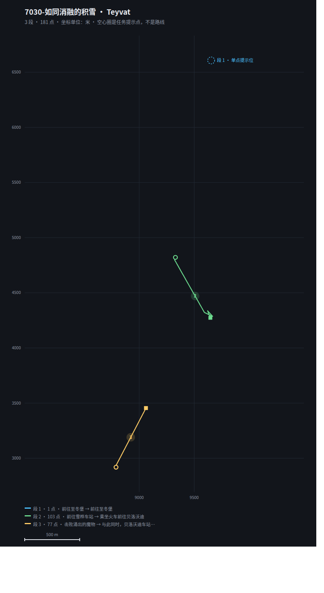
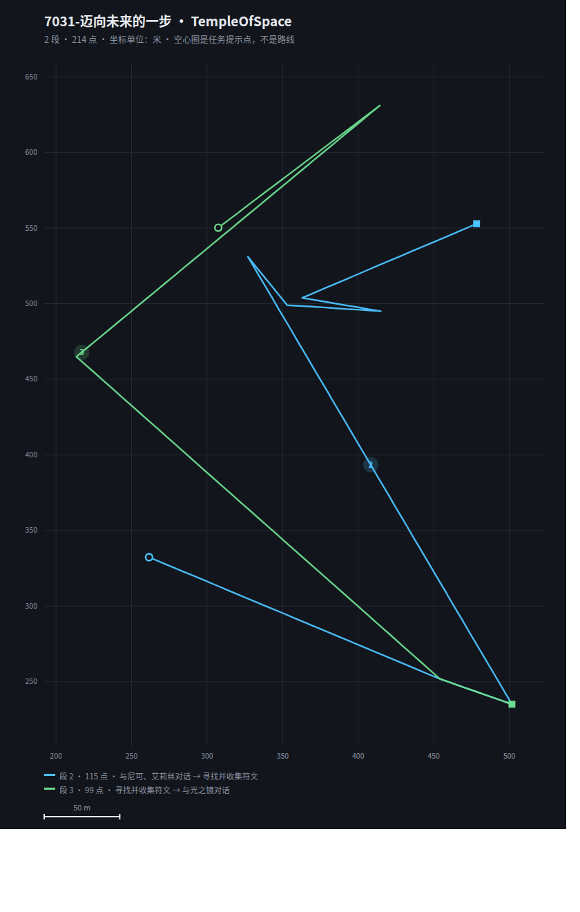

<p align="center">
  
</p>

<h1 align="center">主线自动跑图脚本 · BetterGI</h1>

<p align="center">第四章 枫丹 → 第七章 至冬 · 102 个任务脚本 · 274 段路线 · 9,827 个路点</p>

按 **篇章 → 幕 → 任务** 组织。每个任务一个独立项目：`manifest.json` 声明元信息，`main.js` 负责传送与串段，路线放在 `pathing/*.json`，由 `pathingScript.runFile()` 调用。

> **BetterGI 只认文件夹，不认单个 `.js`。** 最省事是订阅；手动装必须把整个任务文件夹放进 `User\JsScript\`，不能带层级（见[安装](#安装)）。

## 安装

订阅（推荐）：BetterGI → 脚本仓库 → 添加仓库

```
地址：https://github.com/Baisuyy/BGI-quest-scripts
分支：main
```

首次整仓 clone 约 4 MB，之后在仓库页按 `篇章 → 幕 → 任务` 浏览运行。

不订阅、直接放本地：

```powershell
.\install.ps1 -BgiRoot "D:\BetterGI"              # 脚本 + 路线
.\install.ps1 -BgiRoot "D:\BetterGI" -NoPathing   # 只装脚本
```

脚本平铺复制到 `User\JsScript\`，路线复制到 `User\AutoPathing\<篇章>\<幕>\<任务>\`。可反复执行。

## 目录

```
repo.json                        订阅索引，新增任务后跑 tools/build_repo_json.py 重建
js/
  第四章-枫丹/第一幕-白露与黑潮的序诗/4004-独舞者的序幕/
    manifest.json                名称、版本、入口
    main.js                      传送 → runFile → 跳对话
    pathing/01.json …            8 米加密后的路线
  第四章-旅人章/  第五章-纳塔/  第五章-旅人章/
  空月之歌-挪德卡莱/  第七章-至冬/
  原始-第七章-至冬/             7030、7031 的原样（单点段也保留）
  路径优化-第七章-至冬/         同上两份的优化版，见下文
  _tools/ai-agent/               脚本侧 AI（可选，默认纯规则、不联网）
docs/                            主线解析、路线质量、路径地图、优化对比
```

顶层目录必须叫 `js`：订阅索引里的脚本根节点名是硬编码的（`prefix = "js"`），改名订阅后列表为空。

### 两份剧情脚本的对照版本

7030、7031 各存两份，放在与篇章同级的目录下：

| 目录 | 内容 | 段 | 点 |
|---|---|---:|---:|
| `原始-第七章-至冬/` | 生成器产出的原样，单点段也在 | 7 | 397 |
| `路径优化-第七章-至冬/` | 移除单点段、补最近锚点、合并重合点 | 4 | 393 |

优化版由 `tools/quest/optimize_story_route.py` 从原始版生成，可重复执行；**坐标没有重算**。
两种都跑不通全程：7030 的段 2、3 在火车上，7031 的段 2、3 在空之神殿内部，脚本会按 `skipSegs` 跳过。
逐段对比见 [`docs/路径优化对比.md`](docs/路径优化对比.md)，路线图见 [`docs/路径地图/`](docs/路径地图/)。

路线按地图分开画：提瓦特和空之神殿的坐标差两个数量级，画在一张图上只会重叠成一团。





> 为什么叫 `原始-第七章-至冬` 而不是 `js/原始/第七章-至冬`？多一层目录会让 `User\JsScript`
> 下的脚本项目多套一层，而 BGI 只扫一级目录，装完就找不到脚本。所以把标记放在篇章名上。

## 覆盖

| 篇章 | 幕 | 任务 | 已出脚本 | 段 | 路点 |
|---|---:|---:|---:|---:|---:|
| 第四章 枫丹 / 旅人章 | 6 | 26 | 22 | 47 | 1,358 |
| 第五章 纳塔 / 旅人章 | 7 | 26 | 24 | 58 | 2,711 |
| 空月之歌 挪德卡莱 | 11 | 35 | 34 | 111 | 3,349 |
| 第七章 至冬 | 6 | 23 | 18 | 47 | 1,619 |
| 原始-第七章-至冬（7030、7031） | 1 | 2 | 2 | 7 | 397 |
| 路径优化-第七章-至冬（同上） | 1 | 2 | 2 | 4 | 393 |
| **合计** | **55** | **261** | **102** | **274** | **9,827** |

序章到第三章为 0：4.0 之前 `subQuests[].guide` 只给命名点位（如 `Q100001Player`），没有世界坐标。逐幕明细与逐段风险见 [`docs/`](docs)。

## 使用

1. 在「脚本」或「脚本仓库」里选中任务，点运行
2. 先把角色传到该幕起始传送点（脚本内传送只做段间跳转）
3. 沿途自动跳对话、自动选第一项

跑到一半断了，改配置跳过前置段：

```js
startSeg: 3,          // 单任务：从第 3 段开始
startFrom: '7027/5',  // 全流程：从 7027 的第 5 段开始
```

路线按 **8 米步长**加密（`MoveTo` 到达阈值 4 米，更密反而每点一进去就判到达），不改变路径形状。

## 边界

只做三件事：传送到段首附近、沿路线跑图、跳过对话。**不会**解谜、战斗、判断任务是否激活、处理过场动画。

- 11 个任务只有命名点位、无法生成坐标（4006、4024、5010、5022、6008、7006–7008、7019、4026、8022）
- 室内与副本用局部坐标系，`genshin.tp` 定位不到，整段跳过
- 路线是直线插值，不是录制路径：遇山体、河流、建筑会撞上去，靠卡死检测脱困，失败就停在原地
- 传送只到最近的锚点，然后步行；106 个段只有单点，就是「传过去 → 直走」

## 特别版客户端

[Releases](../../releases) 有自编译的 BetterGI 特别版：宿主 API 与内置大模型，默认全部关闭，不开时与官方版行为一致。

| 接口 | 用途 |
|---|---|
| `ocr.readScreen()` / `ocr.readRegion(x, y, w, h)` | 屏幕或指定区域转文字，返回带坐标与置信度的行 |
| `quest.tracker()` | 读左上角任务面板的标题与当前步骤 |
| `ai.Chat(text)` | 调大模型，密钥留在客户端，脚本拿不到 |
| `OcrFactory` / `Bv` | OCR 引擎与 BgiVision 判定，供脚本自行组合 |

**内置大模型**：跑图第 3 次卡死、原本要放弃整条路线时，BGI 自己抓坐标与状态交给模型，由它调用走位、传送、开关功能等工具接管脱困，到达或拉近 5 米后交还路线逻辑。配置入口：*任务设置 → AI 智能决策（内置）*，说明见 [`AI-内置决策.md`](https://github.com/Baisuyy/BGI-quest-scripts/blob/bgi-special/Docs/AI-内置决策.md)。

源码在 [`bgi-special`](../../tree/bgi-special) 分支，单提交快照（不带上游历史，避免订阅时多下几百 MB）。手动跑 `Build BGI Special` 出包，`Sync Upstream BGI` 每天跟一次上游，失败开 issue。解压后覆盖原目录即可，先备份 `User`。

## 文档

- [`docs/主线解析/`](docs/主线解析) — 53 幕解析成果
- [`docs/路线质量报告.md`](docs/路线质量报告.md) — 逐段点数、总长与风险分级
- [`docs/AI-代理.md`](docs/AI-代理.md) — 脚本内自定义 AI 决策（可选）
- [`docs/锚点开启-调研.md`](docs/锚点开启-调研.md) — 自动开锚点可行性与卡点
- [`docs/任务点与地图指引-调研.md`](docs/任务点与地图指引-调研.md) — 靠任务点/地图指引自动到达任务目标
- [SPECIAL-API.md](https://github.com/Baisuyy/BGI-quest-scripts/blob/bgi-special/Docs/SPECIAL-API.md) — 特别版脚本宿主 API
